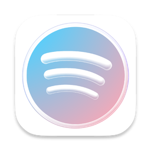
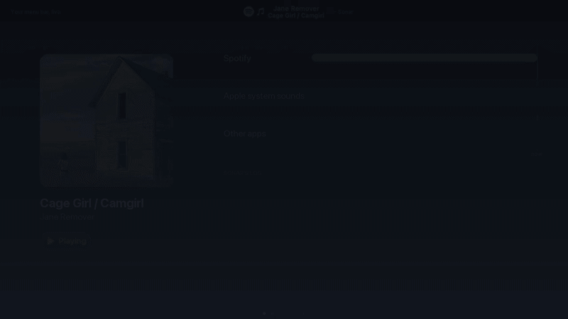
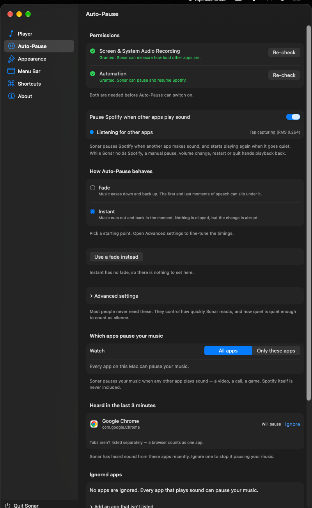

<div align="center">
  
  <h1>Sonar</h1>
  <p><strong>Spotify in your macOS menu bar, with hybrid auto-pause.</strong></p>
</div>

<p align="center">
  
</p>

<p align="center">
  <a href="https://github.com/Kathir-D/Sonar/actions/workflows/ci.yml"></a>
  <a href="https://github.com/Kathir-D/Sonar/releases"></a>
  
  <a href="LICENSE"></a>
</p>

Sonar puts the current Spotify track in your macOS menu bar, and gets out of the way when something
else starts making noise: it pauses the music, then starts it again once the room goes quiet.

It measures real loudness with a Core Audio tap (falling back to process polling), so a paused
video doesn't hold your music hostage. It only ever resumes Spotify if *it* paused it, so a pause
you made yourself is never undone. Apple notification and system sounds are ignored.

It's a fork of [SpotMenu](https://github.com/kmikiy/SpotMenu) with a new auto-pause engine on top.

## Install

Requires macOS 15+ and the Spotify desktop app (no Premium needed).

```sh
brew tap Kathir-D/tap
brew trust Kathir-D/tap
brew install --cask sonar
```

Update with `brew update && brew upgrade --cask sonar`. You can also grab the zip from the
[releases page](https://github.com/Kathir-D/Sonar/releases), or build from source with
`scripts/build-app.sh` (output in `dist/Sonar.app`).

Sonar is ad-hoc signed, not notarized. If macOS blocks it, use **System Settings › Privacy &
Security › Open Anyway**. Because of the ad-hoc signature, macOS asks for permissions again after
every update.

## Usage

Click the menu-bar item for artwork, playback controls, a scrubber and a like button. Global
shortcuts, layout and theming are in Preferences.

**Liking tracks** needs a free Spotify app: create one in the
[developer dashboard](https://developer.spotify.com/dashboard), add the redirect URI
`com.kathird.sonar://callback`, then paste the Client ID into Preferences › Music Player and log in.

## Auto-Pause

Turn it on in Preferences › Auto-Pause. It needs two permissions, and the pane walks you through
both:

- **Screen & System Audio Recording**, to measure how loud other apps are.
- **Automation** for Spotify, to pause, resume and set the volume.

Pick a preset: **Fade** eases the music down and back up, **Instant** cuts it out and back in
(about 0.3 s each way). *Advanced settings* lets you tune trigger delay, resume delay, fade length
and sensitivity, and you can limit auto-pause to specific apps.

Sonar also writes its state to `~/Library/Application Support/Sonar/state.json`, which
[Trak](https://github.com/Kathir-D/Trak) reads.

How it works, in depth: [docs/HOW-AUTOPAUSE-WORKS.md](docs/HOW-AUTOPAUSE-WORKS.md).



## Troubleshooting

- **Auto-Pause won't switch on:** one of the two permissions is missing. If **Grant…** shows no
  prompt, enable it in System Settings, then press **Re-check**. Spotify has to be running for the
  Automation prompt to appear.
- **"Process polling only":** the audio tap isn't getting audio, so Sonar can't tell silence from
  sound. Press **Re-check**, or toggle Screen & System Audio Recording off and on.
- **Empty menu bar:** check Spotify is playing and the Automation permission is granted.
- **Logs:** the path is shown at the bottom of the Auto-Pause pane (usually
  `~/Library/Containers/com.KathirD.sonar/Data/Library/Logs/Sonar/sonar.log`).
- **Known limitation:** a pause you make while Sonar is already holding the music looks the same
  as Sonar's own, so it will still resume.

## Development

Requires Xcode 16+ and Swift 6.

```sh
swift test --package-path Packages/AutoPauseEngine   # engine tests
scripts/build-app.sh                                 # Release build → dist/Sonar.app
```

The Xcode project is still named `SpotMenu.xcodeproj`; build the `Sonar` scheme. Releases are
covered in [docs/RELEASING.md](docs/RELEASING.md). PRs are welcome. Please use conventional commits
and keep the upstream UI unchanged.

## Credits

Fork of [SpotMenu](https://github.com/kmikiy/SpotMenu) by [@kmikiy](https://github.com/kmikiy)
(MIT). The menu-bar UI, preferences, Spotify controller and app icon are from SpotMenu. The poll
detector is ported from [smartpause](https://github.com/yasinozmeen/smartpause) (MIT). Details are in
[THIRD-PARTY-NOTICES.md](THIRD-PARTY-NOTICES.md).

## License

MIT. See [LICENSE](LICENSE).
